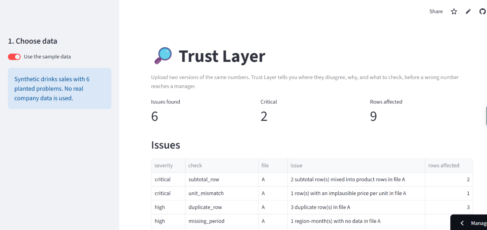

# Trust Layer: find where two versions of the same numbers disagree, and why

[](https://github.com/Kamdirect/trust-layer/actions/workflows/tests.yml)

**[Live app](https://trust-layer-kamal.streamlit.app)** · Python · pandas · Streamlit · pytest · Claude API



## The business problem

Finance, sales and operations teams constantly compare two versions of the same numbers: a system extract against a finance report, positions against a custodian file. When they disagree, someone spends hours finding out why, and sometimes the wrong number reaches a manager first.

In my MSc dissertation, subtotal rows mixed into a sales extract inflated volumes 9.6 times. Nothing flagged it. I built the tool I wish I'd had.

## What I built

- **Upload two files** (CSV or Excel) and get every disagreement between them, ranked by severity.
- **Each issue says what to check next**: remove subtotal rows, re-run a failed upload, ask finance for the journal behind a gap.
- **Reconciliation that separates explained from unexplained gaps.** A gap caused by a duplicate row is labelled as such; a gap with no data cause is escalated.
- **An optional AI summary in plain English**, written by Claude Haiku from the check results only. A rule in code removes any sentence containing a number, month or product that is not in those results, and shows the removed sentences instead of hiding them.
- **The tool never changes the data.** It only reports; the AI only explains what the checks found.

## Results

Tested against synthetic data with 6 deliberately planted problems and an answer key.

| Test | Result |
|---|---|
| Planted problems caught, committed dataset | **6 / 6**, 0 false alarms |
| Planted problems caught, 200 random datasets | **1,200 / 1,200** |
| Clean datasets that raised any alarm | **2 / 200** |
| Outlier check: catches a doubled number (200 unseen datasets) | **97.5%** |
| AI summaries produced, 10 live runs | **10 / 10** (5 / 10 before the fix below) |
| AI sentences containing a wrong number, 10 live runs | **0 of 89** |
| Correct AI sentences wrongly removed by the number check | **1 of 89** (wrote "April 2025" instead of "2025-04") |
| Automated tests | **23 passing**, run on every push by GitHub Actions |

The six planted problems: subtotal rows (one labelled "Total", one with a blank name), duplicate rows, a missing region-month, an unexplained £2,500 finance adjustment, a unit mix-up (bottles entered as cases, ×24), and a ×10 typo.

## What I got wrong and fixed

My first outlier check compared each month with the whole year. On the committed dataset it scored a perfect 6/6, which looked fine until I measured it properly.

Drinks sales swing about ±30% with the seasons, so a whole-year comparison treats large swings as normal. On 200 unseen datasets it **missed 60% of numbers that had been doubled.** It only caught the planted error because ×10 is enormous.

The fix: compare each value with what is normal for that product, region **and month**, and estimate the normal spread across all rows rather than 12 at a time (12 points gave an unstable estimate that made noise look extreme; the first attempted fix was worse than the original).

| Outlier check | False alarms on clean files | Catches ×2 error | Catches ×3 error |
|---|---|---|---|
| Before | 1.0% | 39.5% | 90.5% |
| After | 2.5% | **97.5%** | **100%** |

This is a deliberate trade-off: slightly more false alarms in exchange for catching almost every doubled number. The threshold was tuned on one set of datasets and checked on a different, unseen set, where false alarms were higher (2.5% vs 1.0%), as expected from tuning. Both commits are in the history.

### The AI layer returned nothing half the time

The first live evaluation looked perfect on run 1 (16 sentences, 0 removed). Over 10 runs, **5 returned no text at all.** Claude Haiku 5.5 thinks before answering by default, and thinking counts towards the output token limit, so on some runs it used the whole budget before writing anything. A short summary of given facts needs no up-front reasoning, so thinking is now turned off: **10 / 10 runs produce a summary.** Without the 10-run evaluation, the live app would have shown a blank box to half its visitors.

### A fixed API key kept showing the old error

On the live app, the first click failed (the key was not yet set up correctly). After the key was fixed, every click still showed the same error. The app cached each AI result for an hour to save cost, and it cached failures too, so it kept replaying the old error without contacting the API. Failures are now never cached, and a regression test clicks twice (fail, then succeed) to prove it. The test fails on the old code and passes on the new.

### What the AI numbers do and don't show

In 10 live runs the model never wrote a wrong number, so those runs never tested the number check against a real fabrication. That evidence comes from the automated tests, which feed the check deliberately invented sentences ("saves GBP 50,000", "overstated by 12%", a month that isn't in the data) and confirm each is removed. An early version of the check accepted any digits found anywhere in the results, including inside dates and product names, so "overstated by 11%" would have passed because of "2025-11". It now accepts numbers only from numeric fields.

## How it works

1. **Validate** both files: required columns, numbers that are actually numbers. Bad files get a clear message, not a crash.
2. **Remove structural errors first** (subtotal rows, duplicates) so they don't distort the statistics used by later checks.
3. **Run the checks**: blank values, missing periods, implied price per unit (catches unit mix-ups), seasonally adjusted robust outliers.
4. **Reconcile** region-month totals of A vs B, and label each gap as explained by an issue above, or unexplained.
5. **Report** in the app and as a downloadable Markdown file.
6. **Optionally explain** with AI: only the check results (counts, months, product names, amounts) are sent to the model, never the files. Each sentence of the answer is checked in code before it is shown.

All data is synthetic, generated by `src/synthetic_data.py` with a fixed seed. No real company data is used.

```
src/synthetic_data.py      generates the two files and the answer key
src/checks.py              the deterministic checks (no AI)
src/evaluate.py            scores the checks and runs the 200-dataset stress test
src/report.py              summary, tables, downloadable report
src/explain.py             AI summary and the number check
scripts/evaluate_ai.py     10 live AI runs; every answer saved to docs/ai_evaluation.json
scripts/outlier_sensitivity.py   detection rate vs false alarms on unseen data
app.py                     the Streamlit app
tests/                     23 pytest tests (AI tests use a fake model: no cost)
```

**Run it yourself:**

```bash
python -m venv .venv
.venv\Scripts\activate          # macOS/Linux: source .venv/bin/activate
pip install -r requirements.txt
python -m pytest                 # 23 passed
python -m src.evaluate           # scores and stress test
python -m streamlit run app.py
# optional AI summary: put ANTHROPIC_API_KEY=... in a .env file (never commit it)
```

## Limitations and next steps

- **Explained gaps are matched by region-month, not by amount.** A small duplicate in the same month as an unexplained adjustment would wrongly mark the adjustment as explained. Next fix: subtract each issue's amount and flag any residual.
- Value-based subtotal detection assumes at most one subtotal per region-month.
- The outlier threshold was calibrated on synthetic data with 8% noise; real data would need re-calibration.
- **The test is partly circular.** I designed both the planted errors and the checks that find them, so 1,200/1,200 shows the checks catch the errors I anticipated, not that they catch every real-world error. Real extracts will contain problems I didn't think of.
- The checks assume a fixed column layout (month, region, product, unit, volume, revenue_gbp).
- **The number check verifies numbers, not meaning.** A sentence can use a correct number in a wrong claim ("the duplicates are the largest problem") and pass. Numbers written as words ("two") are not checked.
- **The number check is deliberately conservative.** A true sentence that writes a date differently, or a correct figure like "10x" that is not stored as a fact, is removed. Removed sentences are shown, not hidden.
- 10 live runs is a small sample; the result describes this model, prompt and dataset only.

## How I used AI

I built this with an AI assistant (Claude) as a mentor and pair programmer. It proposed the design and wrote most of the code. I set up the environment and the API account, ran every script and test on my machine, checked each result against the expected output, reviewed and merged every change through pull requests, and decided what to keep. The outlier weakness was found by measuring rather than assuming: the AI's first fix made false alarms worse (71/200 clean datasets), which the stress test exposed before it was committed. The AI layer's empty-response bug was likewise found by running it 10 times, not once.
