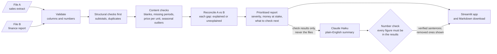

# Trust Layer: find where two versions of the same numbers disagree, and why

[](https://github.com/Kamdirect/trust-layer/actions/workflows/tests.yml)

**[Live app](https://trust-layer-kamal.streamlit.app)** · **[One-page decision memo](docs/decision_memo.md)**


## Executive summary

- **The problem:** when a system extract and a finance report disagree, analysts spend hours
  finding out why. Sometimes the wrong number reaches a manager first.
- **The result:** I ran 200 independent test cases, built after the checks were finished,
  against the two approaches an analyst would normally use.
  - Trust Layer found **99.9%** of planted problems, against **84.8%** for a careful manual
    checklist.
  - That is with about the same review effort: **5.2 items per case against 4.8**.
  - A VLOOKUP-style exact match needed **61 items per case**, and 9 in 10 of them were
    harmless.
- **Where the gain comes from:** errors entered in the source system, which appear in
  **both** files. Comparing the files can't see them: the checklist caught **4%** of these,
  Trust Layer **99%**.
- **Where it falls short:**
  - It still raised a false alarm on **40%** of clean cases (the checklist: 47.5%).
  - It mislabelled **11%** of finance adjustments as unit mix-ups.
- **The design principle:** deterministic checks decide; a language model only explains.
  Every number in the plain-English summary is verified in code: **0 wrong numbers in 89
  sentences** over 10 live runs.

## Business problem

Finance, sales and operations teams constantly compare two versions of the same numbers: a
system extract against a finance report, or positions against a custodian file. When they
disagree, finding the cause is slow, manual work, and the risk is a wrong number in a
management report.

In my MSc dissertation, subtotal rows mixed into a sales extract inflated volumes **9.6
times**, and nothing flagged it. Trust Layer is built to catch exactly that kind of error.

| | |
|---|---|
| **Decision-maker** | Finance or operations manager, before figures are shared |
| **Decision** | Which discrepancies to investigate, in what order, and who should fix them |
| **Cost of getting it wrong** | A wrong number in a management report; or hours spent chasing harmless differences |
| **What Trust Layer provides** | A ranked list of issues, each with the money at stake, the rows affected and what to check next |

## What it does

- **Upload two files** (CSV or Excel) and get every problem in them, ranked by severity and
  then by **money at stake**.
- **Each issue says what to check next**: remove subtotal rows, re-run a failed upload, or ask
  finance for the journal behind a gap.
- **It separates explained from unexplained gaps.** A gap caused by a duplicate row is
  labelled as such. A gap with no data cause is escalated to finance.
- **An optional plain-English summary**, written by a language model from the check results
  only. A rule in code removes any sentence containing a number, month or product that is
  not in those results, and shows the removed sentences instead of hiding them.
- **It never changes the data.** It only reports.

## Architecture



## Methodology

1. **Validate** both files: required columns, and numbers that are actually numbers. A bad
   file gets a clear message, not a crash.
2. **Remove structural errors first** (subtotal rows, duplicates), so that they don't distort
   the statistics used by later checks.
3. **Run the checks:**
   - blank values
   - missing periods
   - implied price per unit (this catches unit mix-ups)
   - seasonally adjusted robust outliers (a median-based z-score against what is normal for
     that product, region **and month**)
4. **Reconcile** region-month totals of file A against file B, and label each gap as either
   explained by an issue above, or unexplained.
5. **Rank and report:** most severe first, then by money at stake. The results appear in the
   app and as a downloadable Markdown file.
6. **Optionally explain.** Only the check results are sent to the model. Each sentence of the
   answer is checked in code before it is shown.

**Testing**, in increasing order of independence:

| Test | What it shows |
|---|---|
| The committed dataset: 6 planted problems with an answer key | The checks find what they were built for |
| 200 random datasets from the same generator | The result is not a fluke of one random draw |
| A separate set of 200 unseen datasets, for the outlier threshold | The threshold was not just fitted to its tuning data |
| **200 independent cases from a different generator**, compared against two baselines | Whether it generalises, and whether it beats what analysts already do |
| 10 live runs of the language-model summary | The summary is reliable and every number in it is real |

All data is synthetic, generated with fixed seeds. No real company data is used.

## Results

### 1. Against the alternatives: 200 independent cases

`src/independent_cases.py` was written **after the checks were finished**. It differs from
the development data on purpose:
- random business shapes;
- harmless credit notes in the finance file;
- problem sizes and labels never used in tuning (×2, ×0.1, "All products", packs of 6);
- a new problem type (blank cells);
- errors that sit in **both** files.

The comparison code was debugged on separate cases. The reported run (cases 1000–1199: 682
planted problems, 40 clean cases) was **run once, and the checks were not changed after
seeing it.** Full method and results: [docs/method_comparison.md](docs/method_comparison.md).

| | Exact match (VLOOKUP) | Simple rules (manual checklist) | **Trust Layer** |
|---|---|---|---|
| Problems detected (recall) | 86.5% | 84.8% | **99.9%** |
| Flags that were real problems (precision) | 10.5% | 85.6% | **89.3%** |
| Clean cases with any false alarm | 100% | 47.5% | **40.0%** |
| Items to review per case | 60.8 | **4.8** | 5.2 |
| False alarms per case | 54.4 | 0.7 | **0.6** |

| Unit mix-ups and wrong values | Exact match | Simple rules | Trust Layer |
|---|---|---|---|
| Error in file A only | 100% | 100% | 100% |
| Error in **both** files | 14.8% | 3.7% | **99.1%** |

Subtotals, duplicates, missing periods, finance gaps and blank cells were found 100% of the
time by all three approaches. **The whole difference is on errors the files agree about.**
Trust Layer named the correct problem type for 97.9% of problems; the baselines don't name
problems at all.

### 2. On the development data

| Test | Result |
|---|---|
| Planted problems caught, committed dataset | **6 / 6**, 0 false alarms |
| Planted problems caught, 200 random datasets | **1,200 / 1,200** |
| Clean datasets that raised any alarm (identical copies, no credit notes) | **2 / 200** |
| Outlier check: catches a doubled number (200 unseen datasets) | **97.5%** |
| Summaries produced, 10 live runs | **10 / 10** (5 / 10 before the fix below) |
| Summary sentences containing a wrong number, 10 live runs | **0 of 89** |
| Correct sentences wrongly removed by the number check | **1 of 89** (wrote "April 2025" instead of "2025-04") |
| Automated tests | **30 passing**, run on every push by GitHub Actions |

*Why are false alarms 1% here but 40% in the independent test?* The development "clean"
files are identical copies. The independent clean cases include small, harmless credit
notes, and those sometimes exceed the 0.1% reconciliation tolerance. The independent figure
is the realistic one.

## What went wrong, and what changed

### The outlier check had a seasonal blind spot
The first outlier check compared each month with the whole year. It scored a perfect 6/6 on
the committed dataset, which looked fine until it was measured properly.

Drinks sales swing about ±30% with the seasons, so a whole-year comparison treats large swings
as normal. On 200 unseen datasets it **missed 60% of numbers that had been doubled.** It only
caught the planted error because ×10 is enormous.

The fix was to compare each value with what is normal for that product, region **and
month**. The normal spread is now estimated across all rows rather than 12 at a time:
12 points gave an unstable estimate that made noise look extreme. The first attempted fix
was worse than the original (71 of 200 clean datasets raised false alarms), and the stress
test caught it before it was committed.

| Outlier check | False alarms on clean files | Catches ×2 error | Catches ×3 error |
|---|---|---|---|
| Before | 1.0% | 39.5% | 90.5% |
| After | 2.5% | **97.5%** | **100%** |

This is a deliberate trade-off: slightly more false alarms in exchange for catching almost
every doubled number. The threshold was tuned on one set of datasets and checked on a
different, unseen set.

### The independent test found a labelling flaw
In **12 of 106** finance adjustments, a large adjustment on a small row made the row's price
per unit look implausible. Trust Layer flagged the row, but **as a unit mix-up, and marked
the gap "explained"**, so it would be routed to the data team instead of finance. The cause:
gaps are matched to issues by place, not by amount. It is reported here rather than fixed,
because changing the checks after seeing the independent test would make that test no
longer independent. The fix, and a fresh test, are the next step.

### The summary returned nothing half the time
The first live evaluation looked perfect on run 1 (16 sentences, 0 removed). Over 10 runs,
**5 returned no text at all.** The model reasons before answering by default, and that
reasoning counts towards the output limit, so on some runs it used the whole budget before
writing anything. A short summary of given facts needs no up-front reasoning, so that step is
now turned off: **10 of 10 runs produce a summary.**

### A fixed API key kept showing the old error
The app cached each result for an hour to save cost, and it cached failures too. So after the
key was fixed, it kept replaying the old error. Failures are now never cached, and a
regression test clicks twice (fail, then succeed) to prove it.

### What the live summary runs do and don't show
In 10 live runs the model never wrote a wrong number, so those runs never tested the number
check against a real fabrication. That evidence comes from automated tests instead, which
feed the check deliberately invented sentences and confirm each one is removed. An early
version accepted digits found anywhere in the results, including inside dates: "overstated
by 11%" would have passed because of "2025-11". It now accepts numbers only from numeric fields.

## Business implications

- **Replace the manual checklist, don't add to it.** Trust Layer finds everything the
  checklist finds, plus errors entered in the source system, with about the same number of
  items to review.
- **Exact matching is the worst option of the three.** It finds slightly more than the
  checklist, but buries the analyst in about 54 harmless differences per case.
- **The gap tolerance is a business decision.** 0.1% catches small real adjustments but flags
  harmless credit notes in about 4 of 10 clean cases. Finance should choose the level it
  will act on.
- **Rank by money, then route by type.** Subtotals and missing periods go to the data team;
  unexplained gaps go to finance. Until the labelling flaw is fixed, a "unit mix-up" in the
  finance file should also go to finance.
- **Language models are safe here only because they are constrained.** The model never
  decides what is wrong. It only describes check results, and every number it writes is verified.
- **Prove it on real data first.** Run it alongside the existing checklist for one month-end
  close before replacing anything. See the [decision memo](docs/decision_memo.md).

## Limitations and next steps

- **Explained gaps are matched by region-month, not by amount.** This caused the 11%
  mislabelling above. The next fix is to subtract each issue's amount and flag any residual.
- **All test cases, including the independent ones, were written by the tool's author.**
  They test generalisation to new sizes, labels and business shapes, not to problem types
  nobody thought of.
- The outlier threshold was calibrated on synthetic data with 8% noise; real data would need
  re-calibration.
- Value-based subtotal detection assumes at most one subtotal per region-month.
- The checks assume a fixed column layout (month, region, product, unit, volume, revenue_gbp).
- **Money at stake can't always be measured.** For an error present in both files there is no
  A-vs-B gap, so the report shows the volume at stake, or a blank.
- **The number check verifies numbers, not meaning.** A sentence can use a correct number in a
  wrong claim and still pass. Numbers written as words ("two") are not checked.
- 10 live summary runs is a small sample. The result describes this model, prompt and dataset only.

## Technology stack

| Area | Tools |
|---|---|
| Language | Python 3.13 |
| Data and checks | pandas, NumPy, openpyxl |
| Language model | Anthropic Claude API (`claude-haiku-5-5`), output verified in code |
| App | Streamlit, deployed on Streamlit Community Cloud |
| Testing and CI | pytest (30 tests), Streamlit AppTest, GitHub Actions |

## Run it yourself

```bash
python -m venv .venv
.venv\Scripts\activate             # macOS/Linux: source .venv/bin/activate
pip install -r requirements.txt
python -m pytest                    # 30 passed, no API key needed
python -m src.evaluate              # development scores and stress test
python -m scripts.compare_methods   # the 3-way comparison on 200 independent cases (~30 s)
python -m streamlit run app.py
# optional summary: put ANTHROPIC_API_KEY=... in a .env file (never commit it)
```

## Project structure

```
src/synthetic_data.py            development data: two files and an answer key
src/independent_cases.py         independent test cases, written after the checks were finished
src/checks.py                    the deterministic checks
src/comparison.py                exact match and simple-rule baselines, and the shared scoring
src/evaluate.py                  scores the checks and runs the 200-dataset stress test
src/report.py                    ranking by severity and money at stake, tables, downloadable report
src/explain.py                   plain-English summary and the number check
scripts/compare_methods.py       the 3-way comparison; results saved in docs/method_comparison*.csv
scripts/evaluate_ai.py           10 live summary runs; every answer saved to docs/ai_evaluation.json
scripts/outlier_sensitivity.py   detection rate vs false alarms on unseen data
app.py                           the Streamlit app
tests/                           30 pytest tests (summary tests use a fake model: no cost)
docs/                            decision memo, method comparison, saved results
```
